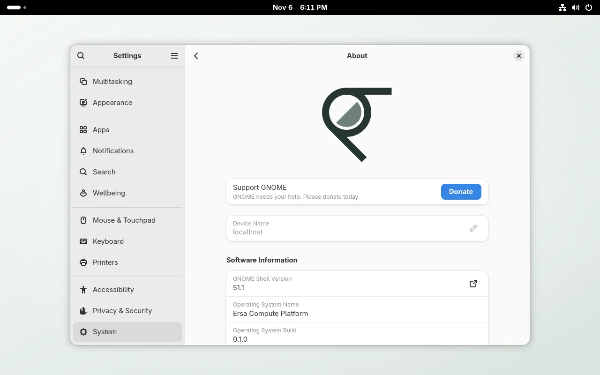

# Branding

## What it is

The Ersa identity on a stock GNOME on Tumbleweed: logo and name in Settings, a boot splash, a login-screen logo, wallpapers
and Inter as the interface font. Sources, build steps and how GNOME picks each asset are in
[branding sources](../branding.md).

| Where | What |
| --- | --- |
| Settings, About | logo, name "Ersa Compute Platform", `IMAGE_VERSION` (from `os-release`) |
| Boot and shutdown | Plymouth theme `ersa` (light) or `ersa-dark`, following the desktop style |
| Login screen (GDM) | the light mark |
| Desktop and lock screen | light and dark wallpapers |
| Installer, Initial Setup | the mark and app icon; the name from `PRETTY_NAME` |

*GNOME Settings, About page, captured from the installer image booted in QEMU.*

## Naming rule

`ECP` is for code only (variables, labels, `IMAGE_ID`). Anything a person reads says "Ersa Compute Platform", never "ECP OS".
A test keeps the acronym out of the installer's text.

## Wallpapers

Two generated wallpapers, light and dark, are the default for the light style, dark style and lock screen, and appear in
Settings under "Ersa". They are soft colour fields (deep green, teal and blue in the dark one; mint, peach and sky blue in the
light one), faint rings echoing the mark's circle and a small mark in the middle. GNOME's own wallpapers
(`gnome-backgrounds`, about 25) are installed beside them. Unsplash photos were considered and not used: its licence says
nothing about bundling photos in an operating system.

## Limits

- The Plymouth artwork was copied from an earlier install; confirm its licence before publishing images.
- The accent colour is libadwaita's blue, not an Ersa colour.
- Other openSUSE logo files and compatibility `os-release` files are not replaced.
- A booted check of Settings, login screen, wallpapers and fonts is still needed.

## Tested

The logos, `os-release` identity, boot splash, GDM logo setting, wallpapers and installer identity are in the repository and the installer image's About page was captured in QEMU. The GDM logo, wallpapers, fonts and boot splash have not been seen on a running desktop, and the Plymouth artwork's licence is undeclared.
