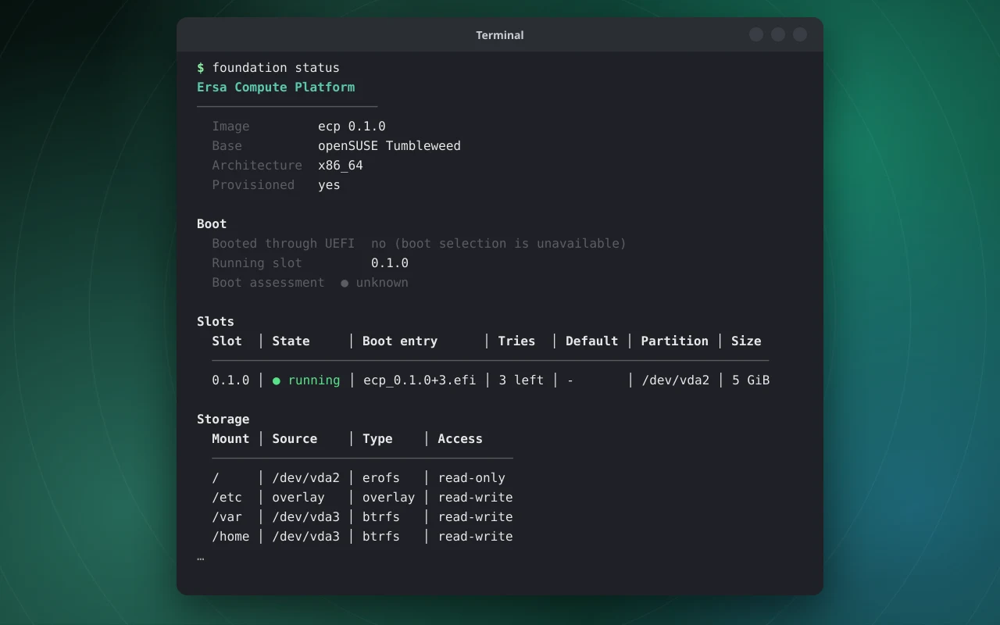

# The `foundation` command line

**Status:** built. Unit tests run every command against a real daemon on a private bus; the end-to-end flows
(slots, deploy, compat) were also run by hand in QEMU.

## What it is

`foundation` is the one supported way to manage the system from a terminal: boot slots, installing the system,
packages and extensions, applications, settings. It is **only a client** of `foundationd`: it holds no policy and
runs no other tool's command line. Everything it can do, a graphical client can do through the same D-Bus calls.

## Commands

```
foundation status                         system, boot slot, storage and services
foundation slot status|boot|copy|release  A/B boot slots
foundation reboot [--firmware]
foundation deploy list|install            install the running system on a disk
foundation repo list|refresh|enable|disable|search|info
foundation compat install|remove|update|bundles|catalog|list|inspect|revalidate
foundation ext list|merge|unmerge|refresh system extensions
foundation apps list|search|info|install|remove|update|setup
foundation config list|get|describe|set|reset
foundation job list|show|cancel|logs
foundation base [FILTER]                  packages in the read-only base image
```

Run `foundation COMMAND --help` for any of them.



*Real output of `foundation status`, captured in QEMU from the installer image (so it shows the live medium: one slot,
direct kernel boot, no UEFI boot selection) and rendered as an image.*

## Habits shared by every command

- **`--json`** on anything that prints data, for scripts.
- **A question before a change**, and `--yes` to skip it. Destructive operations (installing to a disk) need the disk path
  typed back; `--yes` skips that prompt but the daemon still requires the path as confirmation.
- **`--no-wait`** starts a long operation and returns its job at once; follow it with `foundation job show N`.
- **Long operations are jobs.** The command follows the job, shows its steps and progress, and Ctrl-C asks the
  service to cancel it. Before a job's point of no return that stops it cleanly; after it, the command says so and the
  job finishes in the background.
- **Authorization** is polkit. Changes ask for an administrator; on a text-only login without a polkit agent run the
  command with `sudo`. Reading is free.
- **`--no-color`** and `NO_COLOR` disable colour. Output never claims success it did not get: a failed job exits non-zero.

## Examples

```
foundation status
foundation compat install @codecs               # full multimedia codecs, one extension
foundation compat install vlc gimp --into media # two packages and their dependencies, one extension
foundation apps install org.mozilla.firefox
foundation deploy install /dev/nvme1n1 --language de_DE.UTF-8 --timezone Europe/Berlin
foundation config set ota.channel testing
```

## How it works

The command line is `foundation/foundation/cli.py`; it talks to `org.ersa.Foundation1` on the system bus
(`client.py`), follows job objects through their signals, and renders with `ui.py`. See the
[developer guide](../../foundation/README.md) for the request path and how to add a command, and the
[management service](management-service.md) for what is on the other side.

## Limits

- There is no `foundation update` yet ([updates](updates.md)).
- No shell completion is shipped.
