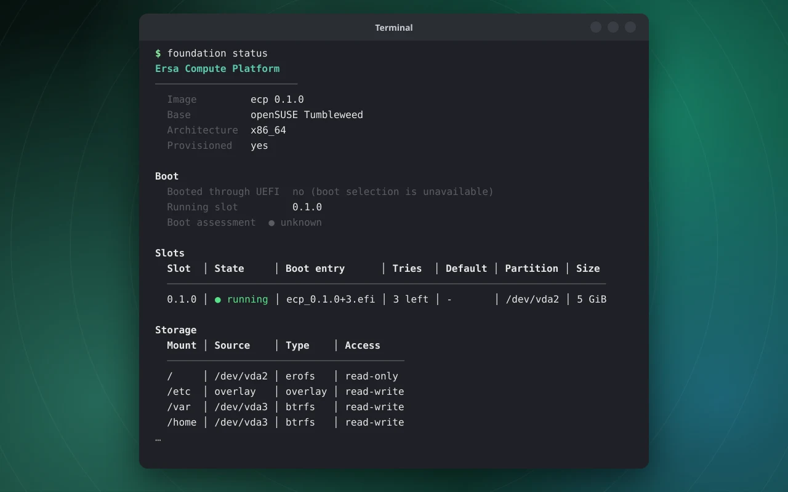

# The `foundation` command line

## What it is

`foundation` is the supported way to manage the system from a terminal: boot slots, installing the system, updates, packages
and extensions, applications, settings. It is only a client of `foundationd` ([management service](management-service.md)): it
holds no policy and runs no other tool's command line. The graphical client is [Deck](deck.md).

## Commands

```
foundation status                         system, boot slot, storage and services
foundation slot status|boot|release       A/B boot slots (boot SLOT [--once])
foundation splash light|dark              boot splash (next boot)
foundation update install|check|status    system updates (see updates.md)
foundation reboot [--firmware]
foundation deploy list|install|check-preseed
foundation apps list|search|info|install|remove|update|setup
foundation apps remotes|remote-add|remote-remove|remote-enable|remote-disable
foundation repo list|refresh|add|remove|enable|disable|search|info
foundation compat install|remove|update|refresh|bundles|catalog|list|inspect|revalidate
foundation ext list|merge|unmerge|refresh [--kind sysext|confext]
foundation remote status|ssh on|off|key list|add|remove      (see remote-access.md)
foundation config list|get|describe|set|reset
foundation job list|show|cancel|logs
foundation base [FILTER]                  packages in the read-only base image
```

`foundation COMMAND --help` describes each. Examples:

```
foundation compat install @codecs                # a catalog bundle, one extension
foundation apps install org.mozilla.firefox
foundation apps install --from acme com.acme.App # from an application source you added
foundation deploy install /dev/nvme1n1 --language de_DE.UTF-8 --timezone Europe/Berlin
foundation deploy install /dev/nvme1n1 --preseed answers.conf --yes    # unattended
foundation config set ota.channel testing
```



*`foundation status` captured in QEMU from the installer image, so it shows the live medium: one slot, no UEFI boot selection.*

## Habits shared by every command

- `--json` on anything that prints data.
- A question before a change; `--yes` skips it. Installing to a disk needs the disk path typed back (`--yes` skips the prompt,
  but the daemon still requires the path as confirmation).
- Long operations are jobs: the command follows steps and progress. `--no-wait` returns the job at once (follow it with
  `foundation job show N`). Ctrl-C asks the service to cancel; after the point of no return the job finishes in the background.
- Changes need an administrator through polkit; on a text login without a polkit agent use `sudo`. A failed job exits non-zero.
- `--no-color` and `NO_COLOR` disable colour.

## How it works

`foundation/foundation/cli.py` talks to `org.ersa.Foundation1` on the system bus (`client.py`), follows job signals and renders
with `ui.py`. The [developer guide](../../foundation/README.md) covers the request path and how to add a command.

## Limits

- No shell completion is shipped.
- `foundation update` installs a given update file or the latest from the feed; the whole update flow is only partly tested
  (see [updates](updates.md)).

## Tested

Unit tests run each command as a real process against a real `foundationd` on a private bus (fake polkit, logind and boot tools). Slots, deploy and compat were also run by hand in QEMU; not on hardware.
