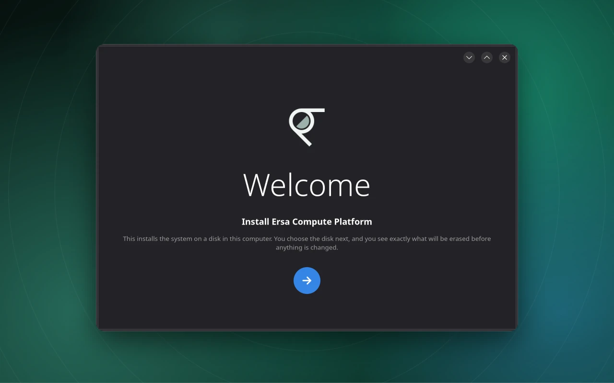
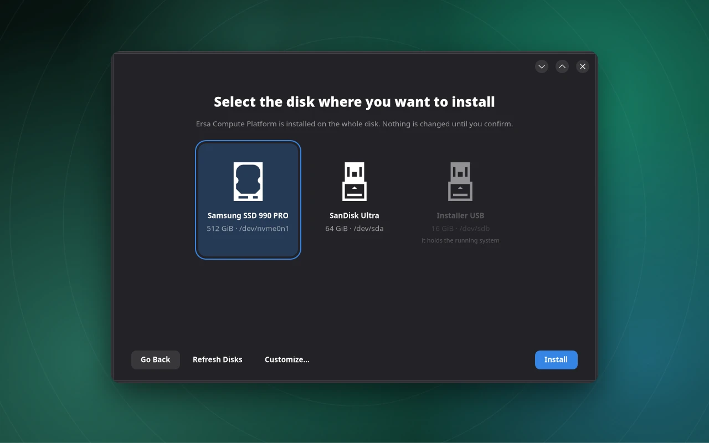

# The graphical installer (`ersa-installer`)

## What it is

A GTK 4 and libadwaita window in the style of the macOS operating system installer: no step sidebar, one centred page at a
time, Go Back and Continue at the bottom right. It is only a client of the `Deploy` interface of
[foundationd](management-service.md); whether a disk may be used comes from the service. On the installer medium
the live session starts it automatically ([installer medium](live-medium.md)).

## The flow

1. **Welcome**: the Ersa mark and "Welcome" in 35 languages in turn. The arrow button or Enter continues.
2. **Language**: a searchable list of 60 languages named in themselves. Sets `/etc/locale.conf` of the installed system.
3. **Time zone**: a searchable list starting at the live system's zone. Sets `/etc/localtime`.
4. **Disk**: one card per whole disk. A refused disk is dimmed with the reason (holds the running system, too small,
   has mounted partitions). Refresh Disks rescans; Customize shows a review of language, zone and partitions.
5. **Install**: the service returns a plan, then a dialog states what will be erased and asks once more.
6. **Progress**: bar, current step, estimated time. The window cannot be closed while the disk is written.
7. **Done** with Restart, or **failed** with the reason and a Show Details log. A failed install leaves a disk that does not
   boot and can be retried.




*Captured from the real application in a headless session; the disks shown are demonstration data.*

Animations are libadwaita's own and follow the desktop's reduce-motion setting. Tests check that they end in the right
state; the motion was only seen in stills.

## Where it lives

`foundation/foundation_installer/` (`app.py` window, `backend.py` async D-Bus and job follower, `model.py` text and
lists), `data/applications/org.ersa.Installer.desktop` (hidden launcher). It is delivered as a system extension, so installed
systems do not carry it.

The window tests open real windows, so they run only on request, on a virtual display:

```
env -u WAYLAND_DISPLAY GDK_BACKEND=x11 GSK_RENDERER=cairo ERSA_GUI_TESTS=1 \
    xvfb-run -a python3 -m unittest discover -s foundation/tests -p test_installer.py
```

## Limits

- The installer's own text is English only.
- No keyboard-layout, network or Wi-Fi screen; no choice of filesystem, no encryption, no dual boot: it erases a whole disk.
- GNOME Initial Setup asks for language and time zone again on first boot, and creates the user.

See also: [deploy](deploy.md), [installer design notes](../installer.md).

## Tested

The real window was driven against a real `foundationd` on a virtual display, including a full install onto a file target. An install from the installer medium onto a blank disk was tested in QEMU (not through the window tests). Not tested: real hardware, screen readers, keyboard-only use beyond Enter on the welcome page, rendering of other languages on a real session.
