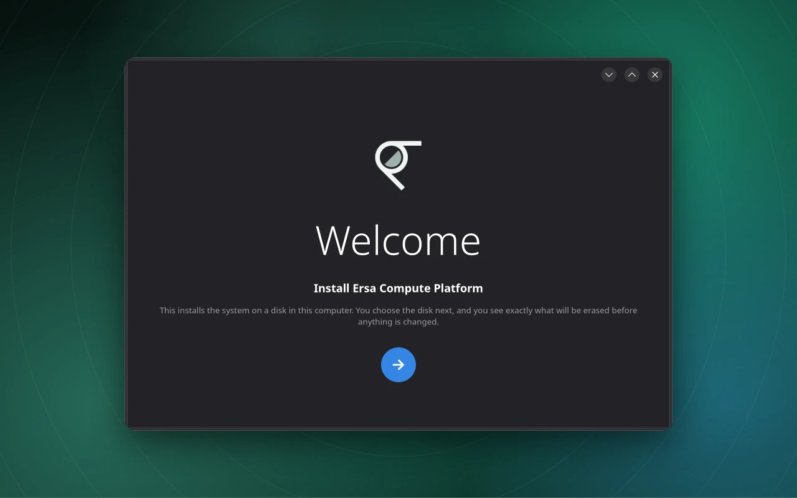
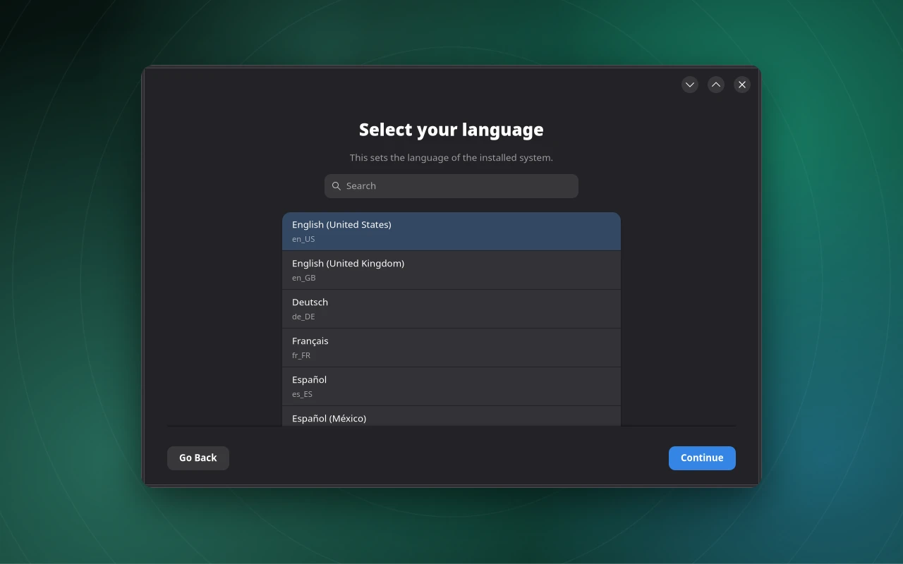
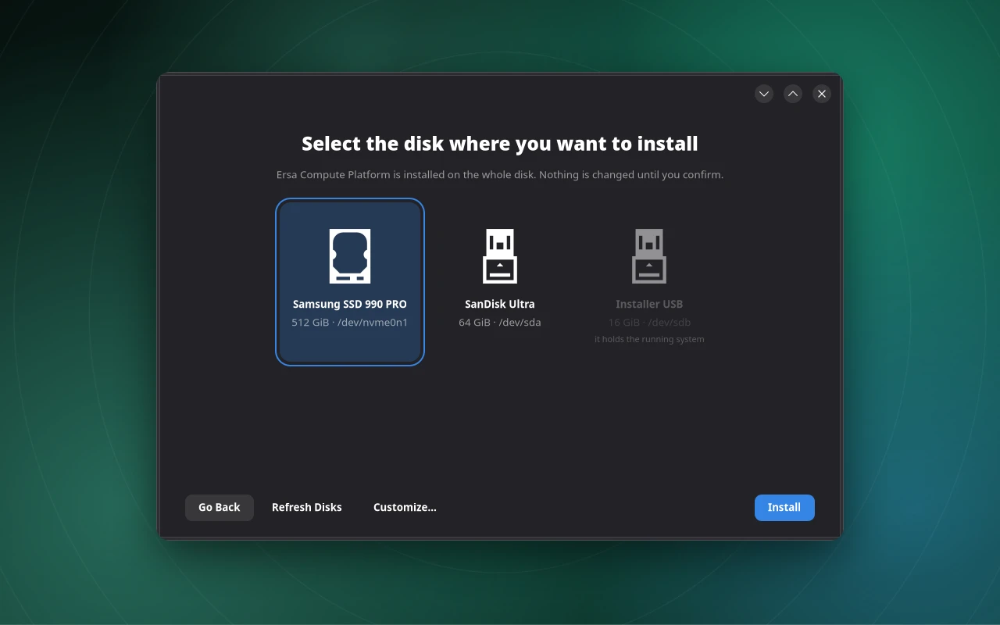
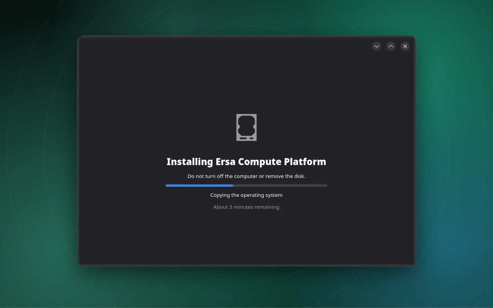

# The graphical installer (`ersa-installer`)

**Status:** built (package `foundation-installer`). Tested: the real window driven against a real `foundationd`
on a virtual display, including a full install onto a file target; text helpers, the greeting, animations' end
states, language and time zone flow. Seen in screenshots from a virtual display and from a booted live session in
QEMU. Not tested: real hardware, screen readers, keyboard-only use beyond Enter on the welcome page, other languages'
rendering on a real session (fonts were added for them but not yet seen).

## What it is

A GTK 4 and libadwaita window in the style of the macOS *operating system* installer (not the `.pkg` installer): no
sidebar of steps, one centred page at a time, Go Back and Continue at the bottom right. It is **only a client** of the
`Deploy` interface of [foundationd](management-service.md): whether a disk may be used comes from the service.

## The flow

1. **Welcome.** The Ersa mark and a large "Welcome" that drifts in from the left, rests and drifts out to the right as
   the next of 35 languages arrives. A round arrow button continues (Enter works too).
2. **Select your language.** A searchable list of 60 languages named in themselves, from English to Santali. This sets
   `/etc/locale.conf` of the installed system.
3. **Select your time zone.** A searchable list of every region/city zone the system knows, starting at the live
   system's zone. This sets `/etc/localtime`.
4. **Select the disk where you want to install.** One card per whole disk. A disk the service refuses is dimmed with the
   reason ("it holds the running system", "it is too small: 6.0 GiB, at least 28.0 GiB is needed", "it has mounted
   partitions"). **Refresh Disks** rescans; **Customize...** shows the review page.
5. **Install** asks the service for a plan, then a dialog says exactly what will be erased and asks once more.
6. **Installing.** A thin progress bar, the current step, an estimated time remaining, a gently breathing disk icon.
   The window cannot be closed while the disk is being written.
7. **Installation complete** (a tick that draws itself) with **Restart**, or **Installation failed** with the reason and a
   "Show Details" log. A failed install leaves a disk that does not boot and is safe to retry.

The **review page** (Customize...) lists the language, the time zone and the partitions that will be created.

### Screens






*The installer window, captured from the real application in a headless session and placed on the Ersa wallpaper. The
disks and progress shown are demonstration data, not an install in progress.*

## Animations

Native libadwaita animations (no extra dependency; GTK has no Lottie player): the greeting flow, direction-aware page
slides, staggered fade-in of each page's parts and of the disk cards, an eased progress bar, the breathing icon, and the
self-drawing tick (drawn with GTK's own path API, so it needs no cairo bindings). They follow the desktop's reduce-motion
setting. The tests check that each animation ends in the right state; the motion itself was only looked at in stills.

## Where it comes from

`foundation/foundation_installer/` (`app.py` window, `backend.py` async D-Bus and job follower, `model.py` text and
lists), the Ersa mark and arrow SVGs beside it, `data/applications/org.ersa.Installer.desktop` (hidden launcher) and
`data/icons/org.ersa.Installer.svg`. On the installer medium it is delivered as a system extension, so installed systems do
not carry it ([installer medium](live-medium.md)).

## Running the window tests

The tests open real windows, so they only run on request, on a virtual display:

```
env -u WAYLAND_DISPLAY GDK_BACKEND=x11 GSK_RENDERER=cairo ERSA_GUI_TESTS=1 \
    xvfb-run -a python3 -m unittest discover -s foundation/tests -p test_installer.py
```

## Limits

- The installer's own text is English only (the chosen language applies to the installed system).
- No keyboard-layout, network or Wi-Fi screen. GNOME Initial Setup handles the keyboard on first boot; networking
  matters for the installer once updates exist.
- No choice of data filesystem, no encryption, no installing next to another system: it erases a whole disk.
- GNOME Initial Setup still asks for language and time zone again on the first boot of the installed system.

See also: [deploy](deploy.md), [installer medium](live-medium.md), [docs/installer.md](../installer.md) (design notes).
