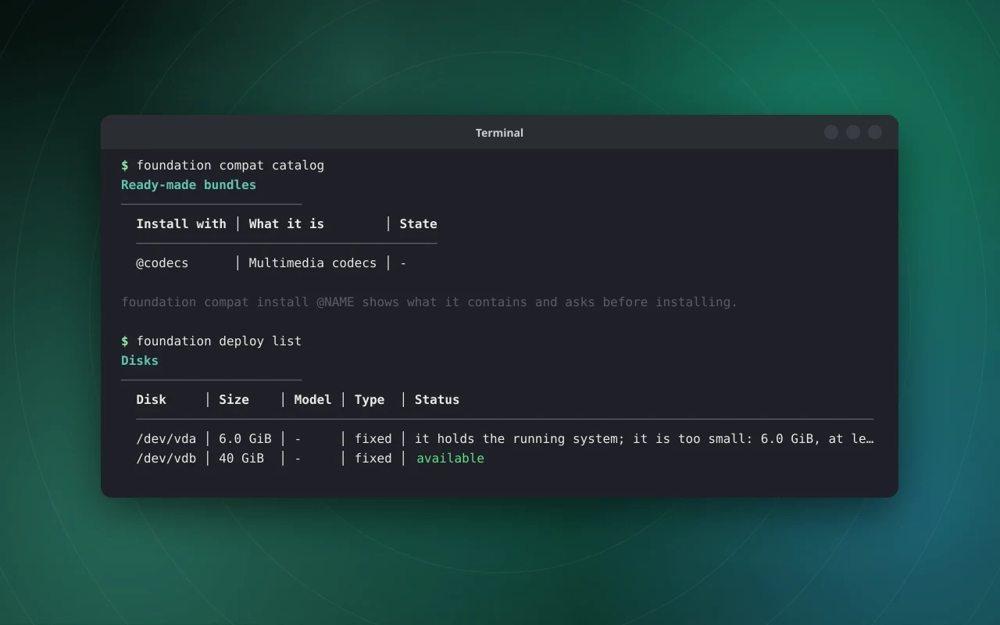

# Repositories and bundles

## What it is

The root is read-only, so packages cannot be installed into it. Packages from signed repositories go into a **bundle**, and
a bundle is one [system extension](system-extensions.md) overlaid on `/usr` and `/opt`. Bundles are for things that must live
in `/usr`: codecs, plugins, drivers, tools. Applications are Flatpaks ([applications](applications.md)).

## Using it

```
foundation repo list | refresh | search ffmpeg | info libx264-165

foundation compat install vlc gimp --into media     # packages (and what they need) into the bundle "media"
foundation compat install @codecs                   # a ready-made bundle from the catalog
foundation compat bundles                           # bundles and their contents
foundation compat remove media gimp                 # one package; its exclusive dependencies go too
foundation compat remove media                      # the whole bundle
foundation compat update                            # newest packages, every bundle (no automatic update)
```

Plain package names go into the bundle `extras`. `@NAME` shows what the bundle is and its notice (for `codecs`: third-party
repository, some codecs patent-encumbered in some countries) and asks before turning on a disabled repository.



*Real output captured in QEMU from the installer image, rendered as an image.*

## How a bundle is built

1. **Solve** the whole bundle with libsolv against the base's packages plus the other bundles' (nothing duplicated).
   Recommended packages are not pulled in. A catalog entry can pin a package to a repository or mark it `when_installed`
   (replaced only if the base has it).
2. **Download** what is missing (six at once) into `/var/lib/foundation/bundles/<name>.rpms`, checking checksum and signature.
3. **Build** a new tree beside the old one: unpack every RPM with the strict reader, report scriptlets instead of running
   them, handle `/etc` and `/var` as described in [system extensions](system-extensions.md), write `extension-release`, and
   label every file for its merged path.
4. **Swap and merge** (`systemd-sysext refresh`); on failure the previous bundle is restored.

Adding or removing a package rebuilds the bundle, so conflicts show up together. A bundle whose libraries another bundle uses
cannot be removed first. `compat revalidate` rechecks bundles after an OS update and disables (not deletes) those that no
longer fit.

## What is trusted

Each repository names its signing key by file (`gpgkey=file:///usr/share/foundation/keys/...`); keys are never fetched.
`repomd.xml` needs a valid detached signature from that key, the package list must match the checksum in it, and every RPM
must match its checksum and carry a valid signature from that key (`rpmkeys`, private keyring). Only https and file URLs are
accepted, sizes are capped, and a repository cannot switch the checks off. Pinned fingerprints are in the
[developer guide](../../foundation/README.md#repositories-and-bundles).

## Repositories

zypp `.repo` format. Shipped ones are in `/usr/lib/foundation/repos.d`: `opensuse-oss` (on) and `packman-essentials` (off
until a catalog bundle asks). Local ones are in `/etc/foundation/repos.d`; a section with the same name replaces a shipped
one. Priority follows zypp (lower wins).

```
foundation repo add myrepo https://example.org/repo/ --key myrepo.asc --name "My repository" [--priority N]
foundation repo refresh myrepo
foundation repo remove myrepo
```

`repo add` shows the key's fingerprint and owner and asks before trusting it. It writes
`/etc/foundation/repos.d/myrepo.repo` and `/etc/foundation/keys/myrepo.asc`. The repository must be https with signed
metadata, or the definition is rejected. Shipped repositories can only be turned off; one that a bundle draws from cannot be
removed. The same result by hand:

```
[mine]
name=My repository
enabled=1
baseurl=https://example.org/repo/
gpgkey=file:///etc/foundation/keys/mine.asc
priority=90
```

## The catalog

`/usr/lib/foundation/catalog.d/*.json`, one file per ready-made bundle: `name`, `title`, `description`, `notice`, `repos`,
`packages` (names or `{"name": ..., "repo": ..., "when_installed": true}`). `codecs` replaces the image's FFmpeg libraries
with Packman's full builds and adds x264, x265 and GStreamer codec plugins ([multimedia](multimedia-and-fonts.md)).

## Common messages

| Message | Meaning |
| --- | --- |
| "the package list of X has not been downloaded yet" | run `foundation repo refresh` |
| "not signed by the repository's key" / "does not match the checksum" | wrong or tampered data; nothing was used |
| "not found in the enabled repositories" | wrong name, or the repository is off |
| "the extension could not be merged; the previous state was restored" | merge failed; the old bundle is back |
| "... use libraries from X; remove that first" | another bundle depends on this one |

## Limits

- Solver results depend on the base the daemon runs on; the container test used a stand-in base.
- Bundles are not sandboxed: an extension is trusted code in `/usr`.

See also: [system extensions](system-extensions.md), [SELinux](selinux.md), [management service](management-service.md).

## Tested

Unit tests use real GPG signatures, tampered and mis-signed metadata, checksum mismatches and small real RPMs. The solver, downloads and signature checks were run against the live openSUSE and Packman repositories in a Tumbleweed container, and the `codecs` bundle was built there (29 packages, 265 files, 87 s). Not tested: a bundle merged on a booted image under enforcing SELinux, and bundles after the base image is updated.
