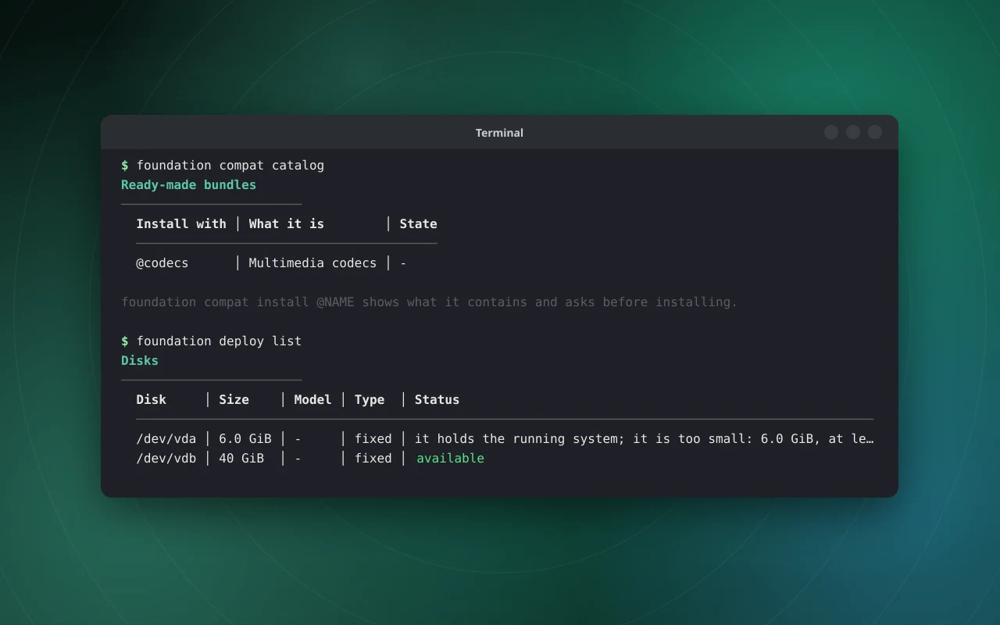

# Repositories and bundles

**Status:** built. Unit tests use real GPG signatures, tampered and mis-signed metadata, checksum mismatches and
small real RPMs. The solver, downloads and signature checks were run against the **live openSUSE and Packman
repositories** in a Tumbleweed container, and the real `codecs` bundle was built there (29 packages, 265 files, 87 s).
Not tested: a bundle merged on a booted image under enforcing SELinux, and bundles after the base image is updated.

## What it is

The root is read-only, so packages cannot be installed into it. Instead, packages from signed repositories are put in a
**bundle**, and a bundle is **one system extension** overlaid on `/usr` and `/opt` (systemd-sysext). One extension holds
many packages, so ten tools are one layer, not ten. Applications are different: they are Flatpaks
([applications](applications.md)). Bundles are for things that must live in `/usr`: codecs, plugins, drivers, tools.

## Using it

```
foundation repo list                                # repositories, whether each is on, how fresh
foundation repo refresh                             # download the signed package lists
foundation repo search ffmpeg                       # find packages in the enabled repositories
foundation repo info libx264-165                    # the newest version per repository, and whether the base has it

foundation compat install vlc gimp --into media     # add packages (and what they need) to the bundle "media"
foundation compat install @codecs                   # a ready-made bundle from the catalog
foundation compat bundles                           # bundles and what is in them
foundation compat remove media gimp                 # take one package out; its exclusive dependencies go too
foundation compat remove media                      # remove the whole bundle
foundation compat update                            # newest packages, for every bundle
```

`compat install @NAME` shows what the bundle is, any notice (for `codecs`: that the packages come from a third-party
repository and some codecs are patent-encumbered in some countries), and asks before turning on a disabled repository.
The default bundle for plain package names is `extras`.



*Real output captured in QEMU from the installer image, rendered as an image.*

## How a bundle is built

1. **Solve.** The whole bundle is solved with libsolv against the packages the base already has plus the packages of the
   other bundles (so nothing is duplicated). Recommended packages are not pulled in. A catalog or request can limit a
   package to one repository, and a package marked `when_installed` is only replaced if the base has it.
2. **Download** only what is missing (six at once) into `/var/lib/foundation/bundles/<name>.rpms`, checking each file's
   checksum and signature.
3. **Build** a new tree beside the old one: unpack every RPM with a strict reader (no scriptlets, nothing outside `/usr`
   and `/opt`, no path escapes), write the `extension-release` file, **label every file for SELinux** for the path it
   will have once merged.
4. **Swap and merge** (`systemd-sysext refresh`). If the merge fails, the previous bundle is restored.

Adding or removing a package rebuilds the bundle with the new package list, so conflicts are found together. A bundle
whose libraries another bundle uses cannot be removed until that one is. `compat revalidate` rechecks bundles like any
other extension after an OS update and disables, without deleting, those that no longer fit.

## What is trusted

Every repository names its signing key by file (`gpgkey=file:///usr/share/foundation/keys/...`); keys are never fetched
from the network. `repomd.xml` needs a valid detached signature from that key, the package list must match the checksum
the signed `repomd.xml` lists, and every RPM must match its checksum and carry a valid signature from the repository's key
(`rpmkeys` with a private keyring). Only https and file URLs are accepted, sizes are capped, and a remote repository
cannot switch the checks off. The pinned key fingerprints are in the [developer guide](../../foundation/README.md#repositories-and-bundles);
compare them with the projects' own pages.

## Repositories

Defined in zypp's `.repo` format: shipped ones in `/usr/lib/foundation/repos.d`, local ones (a section with the same name
replaces a shipped one) in `/etc/foundation/repos.d`. Shipped: **`opensuse-oss`** (on) and **`packman-essentials`**
(off until a catalog bundle asks for it).

### Adding your own

```
foundation repo add myrepo https://example.org/repo/ --key myrepo.asc --name "My repository"
foundation repo refresh myrepo
foundation repo remove myrepo
```

`repo add` reads the publisher's armoured public key, **shows its fingerprint and owner, and asks before trusting it**.
The definition goes to `/etc/foundation/repos.d/myrepo.repo` and the key to `/etc/foundation/keys/myrepo.asc`. The
repository must be https and have signed metadata. `repo remove` deletes both (shipped repositories can only be turned
off, and one that a bundle still draws packages from cannot be removed).

By hand, the same result is a file in `/etc/foundation/repos.d`, such as:

```
[mine]
name=My repository
enabled=1
baseurl=https://example.org/repo/
gpgkey=file:///etc/foundation/keys/mine.asc
priority=90
```

A remote repository must be https, have signed metadata and a key file; otherwise the file is rejected. Priority follows
zypp: a lower number wins.

## The catalog

`/usr/lib/foundation/catalog.d/*.json`: one JSON file per ready-made bundle with `name`, `title`, `description`, `notice`,
`repos` and `packages` (names, or `{"name": ..., "repo": ..., "when_installed": true}`). `codecs` replaces the FFmpeg
libraries of the image with Packman's full builds and adds x264, x265 and the GStreamer codec plugins; see
[multimedia](multimedia-and-fonts.md).

## If something is wrong

| Message | Meaning |
| --- | --- |
| "the package list of X has not been downloaded yet" | run `foundation repo refresh` |
| "not signed by the repository's key" | the metadata or key is wrong; nothing was used |
| "does not match the checksum" | a corrupted or tampered file; nothing was installed |
| "not found in the enabled repositories" | wrong name, or the repository is off (`foundation repo list`) |
| "the extension could not be merged; the previous state was restored" | the merge failed; the old bundle is back |
| "... use libraries from X; remove that first" | another bundle depends on this one |

## Limits

- The solver's results depend on the base the daemon runs on; the container test used a stand-in base.
- Bundles are not sandboxed: an extension is trusted code merged into `/usr`.
- There is no automatic update; run `foundation compat update`.

See also: [system extensions](system-extensions.md), [SELinux](selinux.md), [management service](management-service.md).
